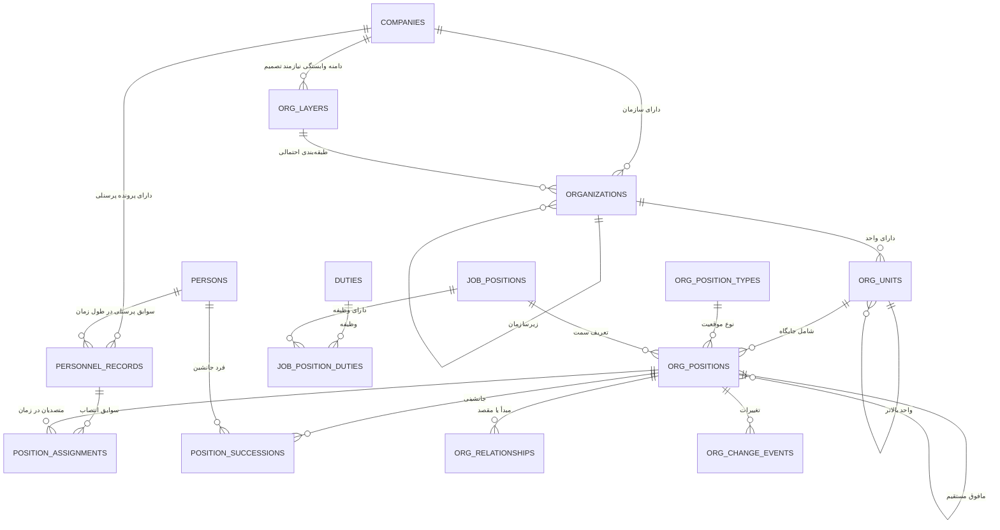
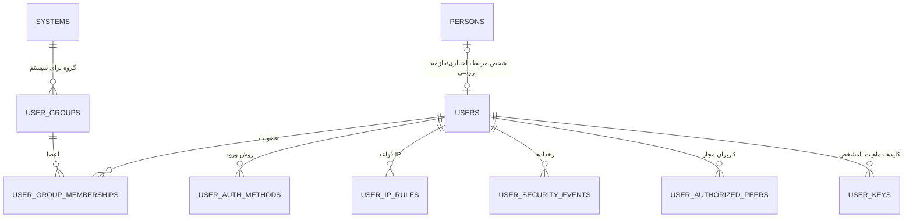

# HR-SOFT — مدل منطقی داده و ERD نسخه ۰.۱

- مبنای تحلیل: `Admino_Master_Document_v1.0.md`
- اسناد مکمل: `HR_SOFT_Architecture_Baseline_v0.1.md` و `HR_SOFT_Security_Analysis_v0.1.md`
- وضعیت: پیش‌نویس منطقی؛ آماده بازبینی پس از تکمیل مشاهده سامانه مرجع
- هدف: تبدیل نیازمندی‌های تأییدشده به ساختار داده قابل پیاده‌سازی، بدون قطعی‌کردن موارد فاقد شواهد

## ۱. اصول مدل‌سازی

1. این سند «مدل منطقی» است، نه اسکریپت migration یا طرح قطعی PostgreSQL.
2. نام جدول‌ها و کلیدها پیشنهادی‌اند؛ نام و رفتار فیلدهای مشاهده‌شده در سند مادر حفظ شده‌اند.
3. هر جا سند مادر فقط وجود یک قابلیت را نشان می‌دهد ولی جزئیات آن روشن نیست، موجودیت پیشنهادی با برچسب «موقت» آمده است.
4. موجودیت‌های شخص، حساب کاربری، پرونده پرسنلی، تعریف سمت، جایگاه سازمانی و انتصاب از هم جدا هستند.
5. داده‌های تاریخی حذف یا بازنویسی نمی‌شوند؛ اصلاحات با ثبت رویداد جدید انجام می‌شود.
6. هیچ الگوریتم قطعی برای ترکیب مجوز گروه‌ها در این نسخه تعریف نمی‌شود.

## ۲. ERD سطح اول — هسته سازمان و نیروی انسانی

> رابطه شرکت با لایه سازمانی در ERD صرفاً یک گزینه طراحی است؛ سند مادر ساختار چندشرکتی و لایه‌های سازمانی را تأیید می‌کند، اما دامنه دقیق تعریف لایه‌ها را هنوز مشخص نکرده است.
>
> **قاعده شخص و پرونده پرسنلی:** مطابق مدل تکمیلی مرحله چهاردهم و Master نسخه 3.4، یک شخص می‌تواند در طول زمان چند پرونده پرسنلی داشته باشد؛ هر پرونده فقط به یک شرکت تعلق دارد. این رابطه به‌تنهایی مجاز بودن اشتغال هم‌زمان در چند شرکت را اثبات نمی‌کند؛ آن سناریو و قواعد هم‌پوشانی باید جداگانه تعیین شوند.

## ۳. فرهنگ داده پیشنهادی

### ۳.۱. شرکت و ساختار سازمانی

| جدول | کلیدها و فیلدهای اصلی پیشنهادی | پشتوانه / وضعیت |
|---|---|---|
| `companies` | `id`، `parent_company_id`، `code`، `title`، `is_active` | چندشرکتی، شرکت مادر/زیرمجموعه و استقلال چارت شرکت‌ها تأیید شده؛ فیلدهای کد/عنوان نیازمند تطبیق با صفحه مرجع |
| `org_layers` | `id`، `code`، `title`، `scope_type` | کد و عنوان مشاهده شده؛ اینکه لایه‌ها سراسری‌اند یا وابسته به شرکت باز است |
| `organizations` | `id`، `company_id`، `layer_id`، `parent_organization_id`، `manager_person_id`، `title`، `is_active` | سازمان و زیرسازمان، مدیر مستقل و ساختار لایه‌ای تأیید شده؛ جزئیات فیلدها کامل نیست |
| `org_units` | `id`، `organization_id`، `parent_unit_id`، `code`، `name`، `management`، `unit_type`، `display_flag`، `shared_code`، `shared_group_head`، `archived_at` | فیلدهای مذکور در سند مادر مشاهده شده‌اند؛ نوع داده و معنای دقیق بعضی فیلدها باید بررسی شود |
| `org_position_types` | `id`، `title`، `priority`، `level`، `display_flag` | عنوان، اولویت، سطح موقعیت و نمایش مشاهده شده‌اند |
| `affairs_offices` | `id`، `code`، `title`، `display_priority`، `is_active` | فیلدها در سند مادر مشاهده شده‌اند |
| `duties` | `id`، `name`، `description` | فیلدها و عملیات پایه مشاهده شده‌اند |
| `position_statuses` | `id`، `name` | عنوان داخلی صفحه «وضعیت پست» و فیلد نام مشاهده شده است |

### ۳.۲. سمت، جایگاه و انتصاب

| جدول | کلیدها و فیلدهای اصلی پیشنهادی | پشتوانه / وضعیت |
|---|---|---|
| `job_positions` | `id`، `title`، `job_description`، `responsibilities`، `authorities`، `qualification_requirements` | مشخصات سمت شغلی در سند مادر به‌عنوان تصمیم معماری تأییدشده آمده است |
| `org_positions` | `id`، `org_unit_id`، `job_position_id`، `position_type_id`، `parent_org_position_id`، `affairs_office_id`، `position_status_id`، `display_flag` | چارت به سمت، واحد اجرایی، موقعیت بالاتر، موقعیت سازمانی اجرایی و امور/دفتر متصل است؛ تطبیق دقیق فیلدها نیازمند مشاهده صفحه است |
| `persons` | `id`، فیلدهای هویتی پس از تحلیل صفحه شخص | وجود صفحه «شخص» و ارتباط کاربر با شخص مشاهده شده؛ جزئیات هویتی در سند فعلی نیست |
| `personnel_records` | `id`، `person_id`، `company_id`، `employee_number`، `employment_status` | هر پرونده پرسنلی به یک شرکت تعلق دارد؛ یک شخص می‌تواند در طول زمان چند پرونده پرسنلی داشته باشد؛ سایر فیلدها تا تحلیل ماژول پرسنلی باز هستند |
| `position_assignments` | `id`، `org_position_id`، `personnel_record_id`، `valid_from`، `valid_to`، `assignment_type`، `created_by` | اتصال پرونده پرسنلی به جایگاه و تاریخچه انتصاب لازم است؛ نام و جزئیات فیلدها پیشنهاد طراحی‌اند |
| `position_successions` | `id`، `org_position_id`، `person_id` یا `employee_id`، `successor_type`، `priority`، `valid_from`، `valid_to`، `reason` | جانشین اصلی/موقت/احتمالی، اولویت، تاریخ و علت در سند مادر تأیید شده‌اند |
| `org_relationships` | `id`، `source_org_position_id`، `target_org_position_id`، `relationship_type`، `valid_from`، `valid_to` | روابط نظارتی، مشاوره‌ای و وظیفه‌ای؛ جدا از سلسله‌مراتب اصلی |
| `job_position_duties` | `job_position_id`، `duty_id`، `sort_order` | جدول واسط پیشنهادی برای اتصال چند وظیفه به سمت؛ کاردینالیتی دقیق باید بررسی شود |

**نکته مهم:** «تعریف سمت» (`job_positions`) با «جایگاه سمت در چارت» (`org_positions`) و «شخص متصدی در بازه زمانی» (`position_assignments`) یکی نیستند. این تفکیک برای نگهداری سمت خالی، تغییر متصدی و تاریخچه ضروری است.

### ۳.۳. پایه سازمانی و ابهام پایه سمت/امتیاز

سند مادر برای «پایه سازمانی» فیلدهایی از جمله شرکت و سازمان، لایه سازمانی، شماره و عنوان سمت، تاریخ تصویب، شماره سمت سرپرست، جنسیت، نوع اقماری، منطقه، نوع سمت، نوع نوبت‌کاری، تاریخ اجرا، سطح زبان، گروه مشاغل، شماره طبقه، رسته سمت، سمت رسمی، سمت طبقه‌بندی‌شده، وضعیت فعال و تاریخچه را ثبت کرده است.

همچنین جدول تاریخ اجرای پایه، پایه مصوب، پایه موقت و توضیحات مشاهده شده است. این داده‌ها در این نسخه به‌صورت یک جدول قطعی ادغام نشده‌اند؛ پیشنهاد می‌شود تا مشاهده فرم و ارتباطات آن، در مدل مفهومی با نام موقت `organizational_bases` و `organizational_base_versions` نگهداری شوند.

صفحه «امتیاز» فقط فیلدهای نام و امتیاز دارد و هنوز مشخص نیست همان «پایه سمت» است یا تنظیم مستقلی. بنابراین جدول نهایی `job_grade` یا `position_grade` ایجاد/تصویب نمی‌شود.

## ۴. ERD سطح دوم — امنیت و مدیریت کاربران

| جدول | فیلدهای پیشنهادی | وضعیت |
|---|---|---|
| `users` | `id`، `person_id`، `username`، `ad_username`، `auth_type`، `is_blocked`، `must_change_password` | اطلاعات حساب و روش‌های احراز هویت مشاهده شده؛ فیلدهای دقیق باید با فرم تطبیق یابند |
| `systems` | `id`، `code`، `title` | فهرست سیستم‌های مشاهده‌شده: مدیریت سامانه، پرسنلی، گردش کار، حضور و غیاب، پورتال، رستوران؛ بخش‌های دیگر در فهرست گروه‌ها نیز دیده شده‌اند |
| `user_groups` | `id`، `system_id`، `title`، `is_active`، `is_archived` | عنوان، سیستم، فعال بودن و آرشیو مشاهده شده‌اند |
| `user_group_memberships` | `id`، `user_id`، `group_id`، `is_default`، `created_at` | چندعضویتی قطعی است؛ گروه پیش‌فرض مشاهده شده ولی معنای دقیق `is_default` باز است |
| `user_auth_methods` | `id`، `user_id`، `method_type`، `external_identifier` | عادی، Active Directory و هر دو مشاهده شده‌اند؛ روش ذخیره‌سازی نهایی باز است |
| `user_ip_rules` | `id`، `user_id` یا `group_id`، `rule_value`، `rule_effect` | وجود مجوز محدوده IP مشاهده شده؛ سطح اعمال و allow/deny نامشخص است |
| `user_authorized_peers` | `id`، `user_id`، `peer_user_id`، `relationship_type` | صرفاً بازنمایی موقت «سایر کاربران مجاز»؛ معنا و اثر دسترسی هنوز نامشخص است |
| `user_keys` | `id`، `user_id`، `key_type`، `key_reference`، `expires_at`، `revoked_at` | صفحه فهرست کلیدها مشاهده شده؛ نوع و کاربرد کلیدها مشخص نیست، پس فیلدها فرضی‌اند |
| `user_security_events` | `id`، `user_id`، `event_type`، `occurred_at`، `source_ip`، `actor_user_id`، `details` | پیشنهاد فنی برای ممیزی؛ باید با گزارش‌های واقعی تطبیق یابد |

**مجوزها عمداً در ERD به‌صورت جدول نهایی نیامده‌اند.** ابتدا باید جزئیات مجوزهای گروه، نحوه ترکیب چند گروه و دامنه داده‌ای مشاهده شوند. پس از آن می‌توان موجودیت‌های `permissions`، `group_permissions` و scopeهای سازمانی را دقیق طراحی کرد.

## ۵. روابط و کاردینالیتی‌های کلیدی

| رابطه | قاعده فعلی |
|---|---|
| شرکت ← سازمان | هر سازمان به یک شرکت وابسته است؛ شرکت می‌تواند چند سازمان داشته باشد |
| سازمان ← زیرسازمان | درختی و با عمق نامحدود |
| سازمان ← واحد | هر سازمان می‌تواند چند واحد داشته باشد |
| واحد ← زیرواحد | درختی و با عمق نامحدود |
| واحد ← جایگاه سازمانی | هر واحد می‌تواند چند سمت/جایگاه داشته باشد |
| سمت شغلی ← جایگاه | مدل پیشنهادی؛ قاعده دقیق یک‌به‌چند یا یک‌به‌یک نیازمند تأیید است |
| جایگاه ← مافوق | هر جایگاه حداکثر یک مافوق مستقیم در ساختار اصلی؛ چند زیردست ممکن است |
| جایگاه ← انتصاب | صفر یا چند انتصاب تاریخی؛ در هر زمان حداکثر یک متصدی اصلی فعال، مشروط به تصویب قاعده |
| کاربر ← گروه | چندبه‌چند؛ چندعضویتی تأیید شده است |
| گروه ← سیستم | گروه به سیستم/ماژول مربوط است؛ کلیدگذاری دقیق پیشنهادی است |

## ۶. قیود یکپارچگی پیشنهادی

این موارد قواعد طراحی برای محافظت از داده‌اند؛ قبل از تبدیل به constraint قطعی باید در مدل فیزیکی و گردش‌های واقعی آزموده شوند.

1. `companies.parent_company_id` نباید به خود شرکت یا یکی از زیرمجموعه‌های خودش اشاره کند.
2. درخت `organizations` و `org_units` نباید چرخه داشته باشد.
3. `org_positions.parent_org_position_id` نباید چرخه ایجاد کند.
4. بازه اعتبار هر انتصاب و جانشینی باید معتبر باشد: `valid_to` خالی یا مساوی/بزرگ‌تر از `valid_from`.
5. برای یک جایگاه، در یک بازه زمانی نباید بیش از یک متصدی اصلی فعال وجود داشته باشد؛ استثناها باید با قواعد رسمی تعریف شوند.
6. جانشینی نباید به‌طور خودکار جایگاه را به متصدی اصلی منتقل کند.
7. شخص/پرسنل متصل به انتصاب باید از نظر شرکت با جایگاه سازگار باشد؛ رفتار انتقال بین‌شرکتی هنوز نیازمند تعریف است.
8. عضویت تکراری یک کاربر در یک گروه باید با قید یکتا جلوگیری شود.
9. حساب مسدود نباید صرفاً به دلیل عضویت گروهی مجاز به ورود تلقی شود؛ رفتار دقیق ورود باید با سیاست احراز هویت مصوب شود.
10. داده‌های تاریخی و رخدادهای ممیزی نباید حذف فیزیکی شوند.
11. شمار نیروی مصوب و شمار نیروی شاغل باید مستقل نگهداری شوند.
12. «گروه پیش‌فرض» نباید تا روشن‌شدن معنایش باعث حذف یا محدودشدن عضویت‌های دیگر شود.

## ۷. تصمیم‌های باز پیش از طراحی فیزیکی

| شناسه | تصمیم باز | چرا مانع نهایی‌سازی است؟ |
|---|---|---|
| DATA-01 | دامنه تعریف لایه سازمانی: سراسری یا وابسته به شرکت | تعیین کلید خارجی و یکتایی کد/عنوان |
| DATA-02 | معنای دقیق «سازمان» در نسبت با شرکت و لایه | تعیین ساختار درخت و مرز داده‌ای |
| DATA-03 | معنای فیلدهای مدیریت، نوع واحد، نمایش، کد مشترک و رئیس گروه مشترک | تعیین نوع داده و روابط واحدها |
| DATA-04 | رابطه دقیق تعریف سمت و جایگاه سازمانی | تعیین کاردینالیتی و محدودیت یکتایی |
| DATA-05 | ساختار کامل پایه سازمانی و نسخه‌های اجرایی/مصوب/موقت | جلوگیری از مدل‌سازی نادرست تاریخچه پایه |
| DATA-06 | ارتباط صفحه «امتیاز» با پایه سمت | جلوگیری از ادغام دو مفهوم نامرتبط |
| DATA-07 | ظرفیت مصوب نیرو در چه سطحی نگهداری می‌شود؟ | تعیین محل ثبت ظرفیت و گزارش کمبود |
| DATA-08 | امکان چند پرونده پرسنلی برای یک شخص در شرکت‌های مختلف | تعیین یکتایی و مدل اشتغال بین‌شرکتی |
| DATA-09 | سیاست انتصاب هم‌زمان و جانشینی | تعیین قید بازه‌های زمانی |
| DATA-10 | ساختار نهایی مجوزها و scopeها | طراحی جدول‌های permission و آزمون دسترسی |
| DATA-11 | معنای گروه پیش‌فرض و ترکیب عضویت‌ها | تعیین الگوریتم دسترسی مؤثر |
| DATA-12 | تنظیمات کاربر، سایر کاربران مجاز و کلیدها | تعیین جداول امنیتی و چرخه عمر |
| DATA-13 | ساختار گزارش‌های دسترسی و ورود | تعیین event schema و retention |
| DATA-14 | چرخه تأیید تغییرات سازمانی | تعیین جداول گردش تأیید و وضعیت تغییر |

## ۸. پیشنهادهای فنی مستقل از رفتار Admino

این بخش توصیه مهندسی است، نه ادعای قابلیت مشاهده‌شده در Admino:

- استفاده از شناسه داخلی پایدار برای هر رکورد؛ کدهای قابل تغییر کسب‌وکار را کلید اصلی قرار ندهید.
- برای ساختارهای درختی در نسخه اول می‌توان از `parent_id` استفاده کرد؛ انتخاب closure table یا مسیر مادی‌شده را پس از سنجش حجم و نیاز گزارش‌گیری انجام دهید.
- زمان‌های اعتبار سازمانی را به‌صورت بازه‌های زمانی روشن و با timezone استاندارد ذخیره کنید.
- عملیات حساس سازمانی را در یک تراکنش انجام دهید: تغییر ساختار، انتصاب، رویداد تاریخچه و درخواست تأیید باید با هم سازگار بمانند.
- تاریخچه تغییرات را از لاگ فنی برنامه جدا کنید؛ تاریخچه کسب‌وکاری باید قابل گزارش و قابل فهم باشد.
- برای داده‌های حساس، کنترل دسترسی در سمت سرور و در لایه query/API اعمال شود؛ پنهان‌کردن گزینه در رابط کاربری به‌تنهایی کنترل امنیتی نیست.
- رمز عبور و secretها نباید به‌صورت متن خام ذخیره شوند؛ جزئیات پیاده‌سازی احراز هویت باید با انتخاب فناوری و الزامات امنیتی جداگانه طراحی شود.

## ۹. مرحله بعدی

پس از تکمیل مشاهده صفحات باقی‌مانده و تعیین تصمیم‌های باز، این مدل به سه خروجی تفکیک شود:

1. ERD فیزیکی و migrationهای پایگاه داده؛
2. قرارداد API و قواعد اعتبارسنجی؛
3. ماتریس آزمون یکپارچگی، تاریخچه و دسترسی.

تا آن زمان، اجرای migration یا ساخت جدول‌های امنیتی نهایی بر اساس این پیش‌نویس توصیه نمی‌شود.
