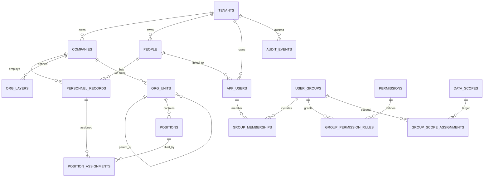

# HR-SOFT — بسته طراحی مرحله دوم
## نسخه ۱.۹ | طراحی تکمیلی گردش کار، ظرفیت، فایل‌ها، اعلان و اطلاعات حساس

- تاریخ: ۱۸ نوامبر ۲۰۲۶
- وضعیت: طراحی مستند؛ هنوز روی هیچ پایگاه داده‌ای اجرا نشده است.
- مبنای طراحی: تصمیم‌های معماری تأییدشده کاربر و تحلیل ثبت‌شده از رابط کاربری Admino.
- اصل حاکم: یک مشتری مستقل = یک Tenant؛ شرکت مادر و شرکت‌های زیرمجموعه درون همان Tenant قرار می‌گیرند.

---

## ۱. ثبت تصمیم‌های قطعی

| موضوع | تصمیم قطعی |
|---|---|
| مرز Tenant | `one`؛ هر مشتری مستقل یک Tenant |
| اصلاح سوابق گذشته | `special`؛ فقط با مجوز ویژه، با ثبت اصلاحیه و حفظ رکورد اصلی |
| حذف اطلاعات | `archive`؛ آرشیو/غیرفعال‌سازی به‌جای حذف فیزیکی |
| اطلاعات حساس | `strict`؛ مجوز مجزا برای مشاهده و دانلود، همراه با ممیزی |

این تصمیم‌ها مبنای طراحی جداول، روابط و کنترل دسترسی هستند.

## ۲. اصول مدل داده

1. شناسه اصلی جداول از نوع UUID است.
2. تمام داده‌های متعلق به مشتری باید `tenant_id` داشته باشند.
3. روابط بین داده‌های متعلق به مشتری با کلیدهای خارجی مرکب شامل `tenant_id` محافظت می‌شوند تا اتصال تصادفی داده دو Tenant ممکن نباشد.
4. «شخص»، «پرونده پرسنلی» و «حساب کاربری ورود» سه مفهوم مستقل‌اند.
5. هر پرونده پرسنلی در نسخه اول به یک شرکت تعلق دارد.
6. شرکت با واحد سازمانی و واحد سازمانی با سمت یکی نیست.
7. تاریخ اعتبار کسب‌وکاری (`valid_from`, `valid_to`) از زمان ثبت سیستمی (`created_at`, `recorded_at`) جداست.
8. حذف فیزیکی سوابق عملیاتی در جریان عادی سیستم مجاز نیست؛ وضعیت و اطلاعات آرشیو ثبت می‌شود.
9. اصلاح گذشته با ایجاد رویداد اصلاحی و نگهداری مقدار قبلی انجام می‌شود؛ تاریخچه نباید بازنویسی شود.
10. داده‌های حساس هویتی/بانکی/مدارک باید در جداول و مسیرهای دسترسی محدودتر قرار گیرند. این نسخه فقط زیرساخت پایه را مشخص می‌کند و جداول اختصاصی اطلاعات بانکی و مدارک در مرحله بعد طراحی می‌شوند.

## ۳. نقشه منطقی موجودیت‌ها

این نمودار نمای مفهومی است؛ فایل SQL ضمیمه ساختار اولیه و کلیدهای خارجی را مشخص می‌کند.

## ۴. طرح جداول نسخه پایه

### ۴.۱ هسته و هویت
- `hr_core.tenants`: مشتری مستقل و مرز جداسازی داده.
- `hr_core.companies`: شرکت مادر/زیرمجموعه در Tenant.
- `hr_core.people`: هویت عمومی شخص.
- `hr_core.personnel_records`: رابطه استخدامی شخص با یک شرکت و شماره پرسنلی.
- `hr_security.app_users`: اتصال شناسه احراز هویت Supabase به حساب داخلی HR-SOFT.

### ۴.۲ ساختار سازمانی
- `hr_org.org_layers`: لایه‌های سازمانی قابل تعریف.
- `hr_org.org_units`: درخت واحدهای سازمانی.
- `hr_org.positions`: سمت‌ها، ظرفیت مصوب و سمت مافوق.
- `hr_org.position_relationships`: روابط نظارتی، مشاوره‌ای و وظیفه‌ای.
- `hr_org.position_assignments`: انتساب اصلی/موقت/قائم‌مقام با تاریخ اعتبار و وضعیت.

### ۴.۳ امنیت و مجوز
- `hr_security.systems`: سیستم/زیرسیستم.
- `hr_security.user_groups`: گروه کاربران؛ هر گروه متعلق به یک سیستم.
- `hr_security.group_memberships`: عضویت کاربر در چند گروه.
- `hr_security.permissions`: کلیدهای مجوز.
- `hr_security.group_permission_rules`: مجوز مستقل افزودن/ویرایش/حذف و اثر allow/deny.
- `hr_security.data_scopes`: محدوده Tenant، شرکت، واحد سازمانی یا پرسنل.
- `hr_security.group_scope_assignments`: محدوده‌های هر گروه با allow/deny.
- `hr_security.temporary_access`: دسترسی موقت با زمان شروع و پایان.

### ۴.۴ ممیزی
- `hr_audit.audit_events`: رویدادهای عمومی ممیزی و تغییرات.
- `hr_audit.permission_change_history`: تاریخچه مستقل تغییر مجوزها.

## ۵. نکات مهمی که عمداً هنوز نهایی/اجرا نشده‌اند

- سیاست RLS نهایی باید پس از تکمیل الگوریتم محاسبه دسترسی مؤثر و آزمایش دو Tenant نوشته شود.
- مدل «deny بر allow اولویت دارد» باید در یک تابع مرکزی و آزمون‌پذیر پیاده شود؛ پراکندن منطق در چند صفحه/کلاینت قابل قبول نیست.
- برای کنترل دسترسی حساس، به مجوزهای جداگانه مانند `sensitive.identity.view`, `sensitive.bank.view`, `sensitive.documents.view`, `sensitive.documents.download` نیاز است.
- جدول‌های بانکی و مدارک در schema محدود و جدا از پروفایل عمومی قرار می‌گیرند.
- جداول workflow، اعلان، ظرفیت/درخواست تغییر، فایل و نسخه فایل، یادداشت مدیران و خروجی ZIP هنوز در Migration پایه نیامده‌اند؛ نیازمندی‌های آن‌ها در سند مادر قبلی ثبت شده و باید در Migrationهای بعدی اضافه شوند.
- برای جلوگیری از چرخه در درخت واحدها و زنجیره سمت مافوق، trigger یا عملیات کنترل‌شده سمت سرور لازم است.
- جلوگیری از هم‌پوشانی انتساب‌های اصلی یک فرد به چند سمت، نیازمند تصمیم دقیق درباره مجاز بودن چندشغلی و قید زمانی است؛ در این نسخه عمداً قید سراسری اعمال نشده است.
- افزونه `citext` در SQL فعال شده تا نام کاربری بدون حساسیت به حروف ذخیره شود. در صورت عدم نیاز، می‌توان آن را حذف و از `text` به همراه ایندکس نرمال‌شده استفاده کرد.

## ۶. ملاحظات Supabase و امنیت

1. هنوز هیچ پروژه Supabase برای HR-SOFT شناسایی یا انتخاب نشده است.
2. هیچ جدول، Migration، کاربر، کلید یا تنظیمی در Supabase ایجاد یا تغییر داده نشده است.
3. تمام جداول قابل دسترسی از Data API باید RLS فعال و سیاست اختصاصی داشته باشند.
4. `auth.users` فقط مرجع احراز هویت است؛ نقش و مجوز تجاری نباید از `user_metadata` قابل ویرایش کاربر استخراج شود.
5. کلید `service_role` یا secret key نباید در مرورگر یا کد سمت کاربر قرار گیرد.
6. Viewها در PostgreSQL 15+ باید در صورت نیاز با `security_invoker = true` ساخته شوند یا در schema غیرقابل دسترس API قرار گیرند.
7. توابع دارای `SECURITY DEFINER` فقط در صورت ضرورت، در schema غیرقابل انتشار، با `search_path` ثابت/خالی، کنترل `auth.uid()` و محدودسازی EXECUTE استفاده شوند.
8. قبل از هر انتشار: آزمون RLS، آزمون دسترسی متقاطع Tenant، آزمون نقش‌های مجاز/غیرمجاز و بررسی Security Advisor الزامی است.
9. نام‌گذاری schemaها و اتصال API باید پس از تصمیم درباره معماری استقرار (backend واسط یا دسترسی مستقیم کلاینت به Supabase) نهایی شود.

## ۷. برنامه مهاجرت‌ها

| شماره | نام پیشنهادی | محتوا | وضعیت |
|---|---|---|---|
| 001 | `core_identity` | Tenant، شرکت، شخص، پرونده پرسنلی، حساب کاربر | پیش‌نویس SQL |
| 002 | `organization_structure` | لایه، واحد، سمت، روابط، انتساب | پیش‌نویس SQL |
| 003 | `security_foundation` | سیستم، گروه، عضویت، مجوز، محدوده، دسترسی موقت | پیش‌نویس SQL |
| 004 | `audit_history` | ممیزی، تاریخچه مجوز، اصلاحیه‌های غیرقابل حذف | طراحی تکمیلی |
| 005 | `workflow_capacity` | گردش کار و درخواست تغییر ظرفیت | طراحی تکمیلی |
| 006 | `files_notifications` | فایل‌ها، نسخه‌ها، اعلان‌ها | طراحی تکمیلی |
| 007 | `sensitive_hr_data` | هویت حساس، اطلاعات بانکی و مدارک | طراحی تکمیلی + تست امنیت |

فایل SQL پیوست فعلاً همه جداول 001 تا 004 را در یک baseline واحد برای بازبینی ساختاری گردآوری کرده است؛ هنگام تبدیل به migrationهای اجرایی باید به فایل‌های کوچک‌تر و مرتب تقسیم شود.

## ۸. آزمون‌های الزامی پیش از اجرا

- کاربر Tenant A نتواند شرکت، شخص، سمت یا پرونده Tenant B را بخواند.
- کلید خارجی نتواند رکورد Tenant A را به رکورد Tenant B متصل کند.
- کاربر غیرفعال یا مسدودشده هیچ دسترسی عملیاتی نداشته باشد.
- عضویت غیرفعال یا گروه غیرفعال در محاسبه مجوز لحاظ نشود.
- deny در هر گروه، allow گروه دیگر را خنثی کند.
- دسترسی موقت پیش از `starts_at` و پس از `ends_at` مؤثر نباشد.
- دسترسی حساس مشاهده و دانلود جداگانه کنترل شود.
- تغییر مجوز، مقدار قبلی و جدید، عامل و زمان را ثبت کند.
- کاربر عادی نتواند رویداد ممیزی را ویرایش یا حذف کند.
- آرشیو، رکورد را از گزارش تاریخی حذف نکند.
- بازسازی وضعیت سازمان در تاریخ گذشته، بر اساس زمان اعتبار و تاریخ ثبت قابل انجام باشد.

## ۹. ثبت اقدامات این مرحله

| اقدام | نتیجه | وضعیت |
|---|---|---|
| ثبت چهار تصمیم معماری | قطعی و مبنای طراحی شد | انجام‌شده |
| تبدیل موجودیت‌های اصلی به جداول | مدل اولیه تهیه شد | انجام‌شده |
| تعیین کلیدهای مرکب tenant-aware | در SQL پایه درج شد | انجام‌شده |
| تفکیک شخص/پرونده پرسنلی/حساب کاربر | در مدل لحاظ شد | انجام‌شده |
| طراحی اولیه ساختار سازمانی | جداول و روابط اولیه تهیه شد | انجام‌شده |
| طراحی پایه گروه/مجوز/محدوده | جداول اولیه تهیه شد | انجام‌شده |
| اجرای SQL روی Supabase | انجام نشد؛ پروژه HR-SOFT هنوز شناسایی نشده | عمداً متوقف |
| آزمون واقعی RLS | انجام نشده؛ نیازمند محیط آزمایشی | باز |
| بررسی صفحه جاری Admino | ابزار خواندن تب مرورگر در این محیط در دسترس نبود | باز |

## ۱۰. نقطه توقف و ادامه خودکار

**مرحله بعدی پیشنهادی و قابل انجام بدون تغییر زیرساخت:**
1. تکمیل جداول workflow، ظرفیت، اعلان، فایل و نسخه‌ها.
2. طراحی جداول اطلاعات حساس با مجوزهای جداگانه مشاهده/دانلود.
3. طراحی الگوریتم محاسبه مجوز مؤثر و شبه‌کد/SQL آن.
4. طراحی سیاست‌های RLS و مجموعه آزمون‌های منفی/مثبت.
5. تقسیم baseline به Migrationهای مستقل و کنترل وابستگی‌ها.
6. آماده‌سازی راهنمای اجرای امن در محیط آزمایشی.

**مواردی که بدون دسترسی/هویت قطعی پروژه یا بدون تأیید هزینه و اثر بیرونی اجرا نمی‌شوند:** ایجاد پروژه جدید، اجرای Migration روی پایگاه داده واقعی، تغییر تنظیمات احراز هویت، انتشار Edge Function، تغییر داده‌های واقعی و انتشار عمومی.

---
## ۱۱. طراحی تکمیلی مرحله بعد

### ۱۱.۱ گردش کار
- `hr_workflow.requests`: سربرگ درخواست مستقل از نوع درخواست.
- `hr_workflow.steps`: گام‌های ارجاع/تأیید و مسئول هر گام.
- `hr_workflow.decisions`: ثبت تصمیم‌های غیرقابل حذف؛ رد درخواست الزاماً دلیل می‌خواهد.

### ۱۱.۲ تغییر ظرفیت سمت
- درخواست تغییر ظرفیت از گردش کار عمومی جدا نگهداری می‌شود تا قواعد اختصاصی آن حفظ شود.
- مقادیر ظرفیت قبلی و پیشنهادی ذخیره می‌شوند.
- وضعیت‌های انتظار تأیید، تأییدشده در انتظار اجرا، ردشده، لغوشده، زمان‌بندی‌شده، معوق، اجراشده و انتظار تأیید مجدد پشتیبانی می‌شوند.
- تغییر درخواست پس از تأیید، نسخه جدید ثبت می‌کند و تأیید را از اعتبار می‌اندازد.
- یادداشت مدیران به‌صورت رکورد مستقل نگهداری می‌شود.
- قید «فقط یک درخواست باز برای هر سمت» باید با قید یکتا/ایندکس جزئی در migration سخت‌سازی اعمال شود؛ تعریف وضعیت‌های باز در این نسخه به‌صورت مستند ثبت شده و پیش از اجرا باید با همه مسیرهای تغییر وضعیت تطبیق داده شود.

### ۱۱.۳ فایل و نسخه
- اطلاعات فایل از بایت فایل جداست؛ بایت‌ها در Storage خصوصی نگهداری می‌شوند.
- هر جایگزینی یک نسخه جدید ایجاد می‌کند؛ نسخه قدیمی حذف نمی‌شود.
- برای نسخه‌های بعد از نسخه اول، علت جایگزینی اجباری است.
- فایل‌های ZIP موقت‌اند و متادیتای مالک، وضعیت، تاریخ انقضا و دانلود ثبت می‌شود.
- سیاست‌های دسترسی دانلود فایل باید هم‌زمان در دیتابیس و Storage اعمال شوند.

### ۱۱.۴ اعلان
- اعلان درون‌برنامه‌ای همیشه فعال است.
- امکان انصراف از SMS برای هر دریافت‌کننده وجود دارد.
- صف اعلان، وضعیت ارسال و شناسه پیامک‌دهنده ثبت می‌شود.
- تشخیص گیرندگان مدیر و جلوگیری از اعلان تکراری باید در منطق سرور انجام شود.

### ۱۱.۵ اطلاعات حساس
- اطلاعات هویتی و بانکی در schema جداگانه `hr_sensitive` قرار می‌گیرند.
- فیلدهای رمز‌شده باید در لایه برنامه رمزنگاری شوند؛ کلید رمزنگاری در پایگاه داده نگهداری نمی‌شود.
- مجوز مشاهده، ویرایش و دانلود مدارک/اطلاعات حساس باید مستقل باشد.
- دسترسی به اطلاعات حساس باید در ممیزی ثبت شود؛ این نسخه جدول پایه اطلاعات را فراهم می‌کند، اما trigger/رویه ثبت مشاهده و دانلود در migration امنیتی جداگانه تکمیل می‌شود.

## ۱۲. الگوریتم محاسبه دسترسی مؤثر

برای هر درخواست دسترسی، سرور باید به ترتیب زیر تصمیم بگیرد:

1. هویت احراز‌شده از `auth.uid()` استخراج شود.
2. حساب داخلی متناظر در `hr_security.app_users` پیدا و فعال بودن آن کنترل شود.
3. عضویت‌های فعال کاربر در گروه‌های فعال همان Tenant و همان سیستم استخراج شود.
4. فقط قواعد مجوز معتبر در زمان فعلی لحاظ شوند.
5. اگر حداقل یک قاعده `deny` معتبر وجود دارد، نتیجه رد است.
6. در غیر این صورت، اگر حداقل یک `allow` معتبر و منطبق با عملیات و محدوده داده وجود دارد، دسترسی مجاز است.
7. در غیر این صورت، دسترسی رد می‌شود.
8. دسترسی موقت فقط در بازه `starts_at <= now() < ends_at` معتبر است.
9. محدوده شرکت/واحد/پرسنل قبل از بازگرداندن هر رکورد ارزیابی می‌شود.
10. مجوزهای حساس جدا از مجوزهای عمومی بررسی و رویداد مشاهده/دانلود ثبت می‌شوند.

**اصل امنیتی:** نبود قاعده به معنی رد دسترسی است (default deny). مجوز مشاهده نیز باید به‌صورت مجوز عملیاتی مستقل در کاتالوگ مجوزها تعریف شود؛ ستون‌های افزودن/ویرایش/حذف به‌تنهایی برای کنترل مشاهده کافی نیستند.

## ۱۳. موارد فنی باز برای سخت‌سازی پیش از Migration اجرایی

- تعریف قید جزئی برای تنها یک درخواست باز ظرفیت برای هر سمت.
- طراحی trigger جلوگیری از چرخه در درخت واحدها و سلسله‌مراتب سمت.
- طراحی توابع امن محاسبه مجوز و scope، با حداقل امتیاز و آزمون نفوذ.
- طراحی RLS دقیق برای هر جدول و Storage policies.
- ثبت ممیزی رویدادهای مشاهده/دانلود اطلاعات حساس.
- تعیین رمزنگاری سمت برنامه، مدیریت کلید و rotation.
- تعیین فرمت‌های مجاز، محدودیت حجم، کنترل MIME واقعی و اسکن بدافزار فایل‌ها.
- پیاده‌سازی زمان‌بند اجرای درخواست‌های تاریخ‌دار، اعلان روز قبل/روز اجرا و تشخیص overdue.
- آزمون idempotency برای اجرای زمان‌بندی‌شده و ارسال اعلان تا اجرای تکراری رخ ندهد.

## ۱۴. ثبت اقدامات تکمیلی نسخه ۱.۹

| اقدام | نتیجه | وضعیت |
|---|---|---|
| تکمیل طراحی گردش کار عمومی | سربرگ، گام و تصمیم | پیش‌نویس تهیه شد |
| تکمیل طراحی درخواست تغییر ظرفیت | درخواست، بازنگری، یادداشت و وضعیت‌ها | پیش‌نویس تهیه شد |
| تکمیل طراحی فایل و نسخه‌ها | شیء فایل و نسخه immutable | پیش‌نویس تهیه شد |
| تکمیل طراحی اعلان | صف اعلان و تنظیم SMS | پیش‌نویس تهیه شد |
| تکمیل طراحی اطلاعات حساس | داده هویتی و بانکی رمز‌شده | پیش‌نویس تهیه شد |
| اصلاح کلید مرکب لایه سازمانی در baseline | قید یکتای `(tenant_id,id)` اضافه شد | انجام شد |
| طراحی نهایی RLS و Storage policies | به علت نیاز به آزمون سناریوهای واقعی | باز |
| اجرای SQL | انجام نشده | عمداً اجرا نشده |

---
پایان بسته طراحی مرحله دوم — نسخه ۱.۹

---

# پیوست مرحله چهارم — امنیت، فایل خصوصی و آزمون‌پذیری
## نسخه تکمیلی 2.2 | ۱۸ نوامبر ۲۰۲۶

این پیوست جایگزین متن نسخه 1.9 نیست؛ یافته‌ها و تصمیمات مرحله چهارم را به آن اضافه می‌کند.

### موارد تثبیت‌شده
- ماتریس دسترسی سطح جدول برای تمام جداول پایه و تکمیلی در `HR_SOFT_Policy_Matrix_v2.2.md`.
- مشاهده و دانلود داده حساس دارای مجوز مستقل و audit مستقل است.
- Storage باید private باشد و دسترسی به فایل به مجوز رکورد مالک وابسته باشد.
- مسیر Storage شامل Tenant، نوع مالک، شناسه مالک، شناسه فایل و شماره نسخه است.
- رویدادهای حساس append-only هستند.
- آزمون‌های دو Tenant پیش از هر انتشار اجباری‌اند.

### اصلاحات طراحی لازم پیش از Migration 0.2
- enforce تطبیق شرکت در org_units، positions و position_assignments.
- کامل کردن CHECK نوع scope.
- ثبت owner registry برای file_objects و حذف اتکا به نام جدول دلخواه.
- یکتا کردن `(storage_bucket, storage_object_path)`.
- تفکیک وضعیت تأیید از وضعیت اجرا در capacity requests.
- enforce append-only روی decisions، revisions، notes، audit و file_versions.
- طراحی permission resolver مرکزی و Storage owner resolver.

### مرز اعتبار
نسخه 2.2 سند طراحی/بازبینی است. هیچ تغییری در Supabase، Auth، Storage یا داده عملیاتی انجام نشده است.

---

# پیوست مرحله پنجم — بازطراحی مدل داده
## نسخه تکمیلی 2.3 | ۱۸ نوامبر ۲۰۲۶

- روابط سازمانی و انتساب سمت باید company-scoped باشند، نه فقط tenant-scoped.
- مالک فایل از حالت polymorphic آزاد به نوع مالک allowlist شده با FK واقعی منتقل می‌شود.
- وضعیت تأیید و وضعیت اجرای درخواست ظرفیت از هم تفکیک می‌شوند.
- اجرای ظرفیت فقط روی آخرین revision تأییدشده مجاز است.
- جداول تاریخچه و فایل‌نسخه‌ها append-only می‌شوند.
- Migration پیشنهادی v0.2 در سند مستقل ارائه شده و هنوز اجرا نشده است.
- برنامه آزمون Migration و چک‌لیست یکپارچگی داده در بسته مرحله پنجم موجود است.

**مرز اعتبار:** این نسخه طراحی است؛ schema واقعی Supabase بررسی یا تغییر داده نشده و هیچ آزمونی اجرا نشده است.

---

# پیوست مرحله ششم — موتور دسترسی و API امن
## نسخه تکمیلی 2.4 | ۱۸ نوامبر ۲۰۲۶

- تصمیم دسترسی در یک موتور مرکزی سمت سرور محاسبه می‌شود.
- کلاینت حق تعیین مرجع `tenant_id`, `company_id`, `org_unit_id`, `personnel_record_id` را ندارد.
- `view` مطابق تصمیم ثبت‌شده ستون مستقل `can_view` ندارد؛ permission فعال + scope معتبر لازم است.
- `download`, `view_sensitive`, `correct_history`, `approve`, `execute` عملیات مستقل‌اند.
- deny در هر گروه بر allow سایر گروه‌ها مقدم است.
- resolver هنوز پیاده‌سازی نشده؛ قرارداد و skeleton امن/deny-only در بسته مرحله ششم ثبت شده‌اند.

---

# پیوست مرحله هفتم — زمان، گردش کار و اعلان‌ها
## نسخه تکمیلی 2.5 | ۱۸ نوامبر ۲۰۲۶

- تاریخ مؤثر از زمان ثبت تفکیک می‌شود.
- انتساب آینده تا زمان اجرا scheduled باقی می‌ماند.
- لغو/تغییر انتساب آینده در تاریخچه ثبت می‌شود و برای آن اعلان کارمند ارسال نمی‌شود.
- اصلاح گذشته فقط با permission ویژه و correction event انجام می‌شود.
- اعلان‌ها از transactional outbox و worker idempotent عبور می‌کنند.
- زنجیره مدیران هنگام اجرای assignment محاسبه می‌شود.
- SMS تابع تنظیم opt-out است؛ in-app همیشه فعال است.
- تغییر ظرفیت، approval و execution جدا و تراکنشی است.

---

# پیوست مرحله هشتم — گزارش‌ها و رابط کاربری
## نسخه تکمیلی 2.6 | ۱۸ نوامبر ۲۰۲۶

- عنوان گزارش‌های مشاهده‌شده در Admino در کاتالوگ گزارش ثبت شد؛ جزئیات ستون و فرمول تا زمان مشاهده/تأیید منبع نامشخص باقی می‌ماند.
- گزارش‌های وابسته به ماژول‌های طراحی‌نشده وارد MVP نمی‌شوند.
- داشبورد و گزارش‌ها با scope و permission سمت سرور محدود می‌شوند.
- خروجی Excel/PDF تابع همان scope و مجوز مستقل export است.
- معماری صفحات فارسی RTL و نقشه توسعه ماژول‌ها ثبت شد.

---

# پیوست مرحله نهم — معماری فنی و برنامه MVP
## نسخه تکمیلی 2.7 | ۱۸ نوامبر ۲۰۲۶

- الگوی معماری هدف Modular Monolith با مرز دامنه مشخص است.
- Supabase/PostgreSQL/Auth/Storage در معماری هدف لحاظ شده، اما پروژه واقعی هنوز بررسی نشده.
- محیط‌های dev/staging/production، CI/CD، logging، monitoring، backup/restore تعریف شده‌اند.
- MVP و Gateهای تحویل مشخص شده‌اند.
- هیچ deployment یا integration بیرونی انجام نشده است.

---

# پیوست مرحله دهم — فرهنگ داده و نقشه Schema
## نسخه تکمیلی 2.8 | ۱۸ نوامبر ۲۰۲۶

- فرهنگ داده از 35 جدول DDL پایه و تکمیلی استخراج شد.
- مالکیت دامنه برای 8 schema ثبت شد.
- queryهای preflight فقط‌خواندنی برای کشف ناسازگاری شرکت، scope، فایل و ظرفیت آماده شد.
- این فرهنگ داده مدل محلی HR-SOFT است و schema واقعی remote را اثبات نمی‌کند.

---

# پیوست مرحله یازدهم — ردیابی به سند Admino
## نسخه تکمیلی 2.9 | ۱۸ نوامبر ۲۰۲۶

- سند Admino_Master_Document_v1.0.md دوباره بررسی شد.
- شکاف‌هایی که در مدل فعلی به‌طور کامل پوشش داده نشده‌اند ثبت شدند: پایه سازمانی کامل، موقعیت سازمانی، وظایف، امور/دفتر، جانشینی، AD، IP policy، گروه پیش‌فرض، گزارش ورود/دسترسی و تابلو اعلانات.
- جزئیات پرسنلی، قراردادها و احکام در سند منبع فعلی صرفاً به‌عنوان کار باقی‌مانده فهرست شده‌اند؛ فیلدهایشان حدس زده نشده است.
- هیچ‌یک از جداول پیشنهادی این مرحله هنوز در DB ایجاد نشده‌اند.

---

# پیوست مرحله دوازدهم — تکمیل مدل سازمانی
## نسخه تکمیلی 3.0 | ۱۸ نوامبر ۲۰۲۶

- پایه سازمانی از سمت و متصدی آن تفکیک شد.
- موقعیت سازمانی، وظایف و امور/دفتر به‌صورت موجودیت‌های مستقل طراحی شدند.
- جانشینی با priority و بازه اعتبار طراحی شد؛ نوع هدف جانشین هنوز پیشنهادی است.
- Migration v0.3 و برنامه آزمون مستقل آماده شد؛ هیچ‌کدام اجرا نشده‌اند.

---

# پیوست مرحله سیزدهم — امنیت حساب، IP و تابلو اعلانات
## نسخه تکمیلی 3.1 | ۱۸ نوامبر ۲۰۲۶

- auth_mode محلی/AD/ترکیبی به‌عنوان مدل پیشنهادی ثبت شد.
- IP CIDR allow/deny و نیاز به trusted proxy تعریف شد.
- گروه پیش‌فرض per user/system طراحی شد.
- login events و access events تفکیک شدند.
- bulletin و acknowledgement per user/placement طراحی شد.
- Migration v0.4 فقط پیشنهاد است؛ هیچ integration یا migration اجرا نشده است.

---

# پیوست مرحله چهاردهم — داده شخص و پرونده پرسنلی
## نسخه تکمیلی 3.2 | ۱۸ نوامبر ۲۰۲۶

- Person، Personnel Record و App User مستقل باقی می‌مانند.
- فیلدهای شناخته‌شده فرم شخص ثبت شدند.
- کد ملی در داده هویتی حساس و موبایل در داده تماس خصوصی نگهداری می‌شود.
- کشور/شهر به‌صورت کاتالوگ مرجع طراحی شدند.
- قراردادها، احکام و سوابق استخدامی جزئی تا زمان دسترسی به فرم‌های واقعی مدل‌سازی قطعی نمی‌شوند.

---

# پیوست مرحله پانزدهم — وضعیت نهایی طراحی و تحویل
## نسخه تکمیلی 3.3 | ۱۸ نوامبر ۲۰۲۶

- دفتر تصمیم‌ها، فرض‌ها و موارد باز تدوین شد.
- بسته handoff برای تیم توسعه آماده شد.
- ترتیب migrationها و Gateهای کیفیت مشخص شد.
- طراحی تا حدی که بدون repository و schema واقعی قابل اتکا باشد ادامه یافت.
- هیچ اجرای remote، deployment یا migration واقعی انجام نشده است.
