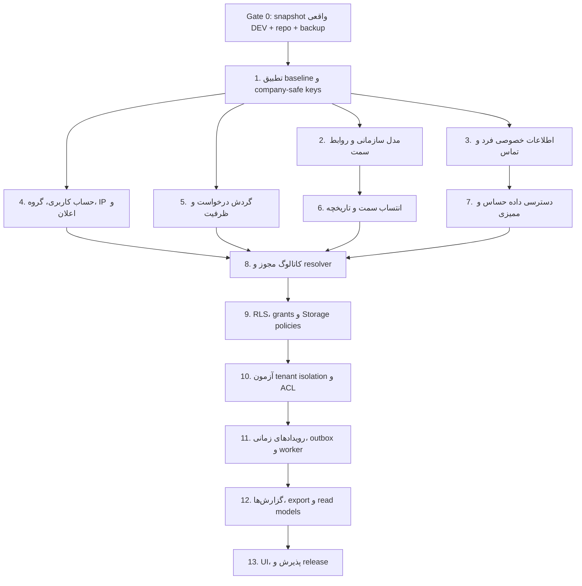

# HR-SOFT — Migration Dependency Graph
## نسخه 0.1 — ترتیب وابستگی، نه مجوز اجرا

## قواعد مسیر بحرانی
1. Gate 0 مقدم بر تمام migrationها است.
2. company-safe FKها باید پیش از افزودن روابط سازمانی/پرسنلی اجرا و آزمون شوند.
3. Access resolver باید قبل از سیاست‌های نهایی RLS و Storage تثبیت شود.
4. هیچ policy permissive گسترده‌ای نباید جایگزین resolver و scope check شود.
5. آزمون دو tenant و سناریوهای explicit deny پیش‌نیاز فعال‌سازی محیط واقعی است.
6. migrationهای داده‌ای باید preflight، backfill، validation و rollback plan داشته باشند.
7. مرحله UI تنها پس از تثبیت قرارداد API و permissionها وارد پذیرش می‌شود.

## مواردی که هنوز باید از schema واقعی تعیین شوند
- نام و نسخه migrationهای واقعی؛
- وجود/عدم وجود جدول‌ها و constraintهای متناظر؛
- سازگاری کلیدها و داده‌های موجود؛
- ترتیب دقیق فایل‌های migration با توجه به وابستگی‌های واقعی؛
- امکان rollback هر تغییر و حجم backfill.
